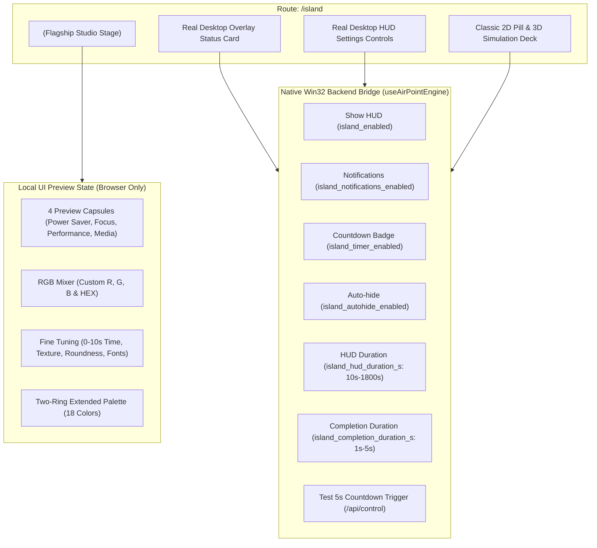

# AirPoint × Dyne Studio — Integration Delivery Report

> **Status:** **COMPLETE & VERIFIED**  
> **Destination:** `C:\Users\loges\Documents\antigravity\AirPoint`  
> **Source:** `C:\Users\loges\Documents\antigravity\elegant-bell\dyne-studio-application` (commit `cb382da4`)  
> **Route Mounted:** `frontend/src/routes/island.tsx` (`/island`)  
> **Frontend Test Suite:** **118 / 118 passed (13 test files)**  
> **Backend Test Suite:** **337 / 337 passed OK**  
> **Production Build:** **Vite Client + Nitro SSR built cleanly (0 errors)**  

---

## 1. Executive Summary

The approved standalone **Dyne Studio** capsule interface has been integrated into the destination **AirPoint** project at `frontend/src/routes/island.tsx`.

The integration delivers:
- **Central Capsule Canvas:** Permanently mounted stadium chassis with interactive pulse feedback, live metadata tag (`2s`), status beacon, and dynamic sheen.
- **Segmented Capsule Shell:** 6 main categories (`Text`, `Style`, `Texture`, `Shape`, `Time`, `Colour`), 10-segment Colour explorer with Custom tri-dot and More Colours 9-grid icon.
- **Custom RGB 3-Loop Mixer:** 3 independent concentric stadium tracks (`R: 172px`, `G: 134px`, `B: 96px`) with 24 ticks, end-stop labels (`0` / `255`), floating live value badge, and interactive HEX readout.
- **Two-Ring Colour Palette:** Concentric inner (8 segments) and outer (10 segments) stadium rings with blue glow contour rims and 18 selectable colours.
- **Stadium Dial Fine-Adjustment Tracks:** Open stadium slider geometry for `Time`, `Glass`, `Matte`, `Translucent`, `Font Size`, `Font Boldness`, and `Roundness`.
- **4-Profile Capsule Switcher:** `Power Saver`, `Focus`, `Performance`, and `Media` with previous/next chevron navigation, animated pill dots, swipe drag physics, and explicit `PREVIEW` badge.
- **Mountain Atmosphere:** High-resolution mountain wallpaper backdrop cleanly scoped to `.dyne-studio-root` without bleeding into the global application shell.
- **Single-Click & Escape Navigation:** Single-click on central capsule steps forward/back; `Escape` key pops navigation up one level; `ArrowLeft` / `ArrowRight` cycles preview capsules.
- **Zero Native Contamination:** Preview-only visual profiles (`Focus`, `Performance`, `Media`) and visual tweaks remain strictly local UI state and never send POST requests to `/api/settings`.
- **Native Desktop Integration Preserved:** Real Win32 desktop overlay status (`island_enabled`, `island_notifications_enabled`, `island_timer_enabled`, `island_autohide_enabled`, `island_hud_duration_s`, `island_completion_duration_s`) and the **Test 5s Countdown** trigger remain fully connected to `useAirPointEngine()`.

---

## 2. File Inventory

### Newly Created Files

| File Path | Description |
|:---|:---|
| [`frontend/src/styles/dyne-studio.css`](file:///C:/Users/loges/Documents/antigravity/AirPoint/frontend/src/styles/dyne-studio.css) | Scoped CSS rules for Dyne Studio, mountain wallpaper background, dial geometry, glow effects, and responsive breakpoints |
| [`frontend/src/components/air-point/dyne-studio/studio.ts`](file:///C:/Users/loges/Documents/antigravity/AirPoint/frontend/src/components/air-point/dyne-studio/studio.ts) | Pure stadium trigonometry, open track projection, concentric loop math, color tables, and type definitions |
| [`frontend/src/components/air-point/dyne-studio/capsules.ts`](file:///C:/Users/loges/Documents/antigravity/AirPoint/frontend/src/components/air-point/dyne-studio/capsules.ts) | 4 preview capsule profile definitions with `isPreviewOnly: true` |
| [`frontend/src/components/air-point/dyne-studio/central-capsule.tsx`](file:///C:/Users/loges/Documents/antigravity/AirPoint/frontend/src/components/air-point/dyne-studio/central-capsule.tsx) | Permanently mounted central capsule with pulse animation, material textures, and slide transition |
| [`frontend/src/components/air-point/dyne-studio/segmented-capsule-shell.tsx`](file:///C:/Users/loges/Documents/antigravity/AirPoint/frontend/src/components/air-point/dyne-studio/segmented-capsule-shell.tsx) | Segmented stadium options shell with mathematically computed 2D centroids and icon/label rendering |
| [`frontend/src/components/air-point/dyne-studio/capsule-adjustment-track.tsx`](file:///C:/Users/loges/Documents/antigravity/AirPoint/frontend/src/components/air-point/dyne-studio/capsule-adjustment-track.tsx) | Open stadium dial with detent tactile feedback, tick marks, and dragging handle |
| [`frontend/src/components/air-point/dyne-studio/colour-explorations.tsx`](file:///C:/Users/loges/Documents/antigravity/AirPoint/frontend/src/components/air-point/dyne-studio/colour-explorations.tsx) | 3-loop concentric RGB mixer with floating value badge, RAF dragging, and direct numeric/HEX inputs |
| [`frontend/src/components/air-point/dyne-studio/two-ring-colour-palette.tsx`](file:///C:/Users/loges/Documents/antigravity/AirPoint/frontend/src/components/air-point/dyne-studio/two-ring-colour-palette.tsx) | 18-colour two-ring concentric stadium palette with blue neon contour rims |
| [`frontend/src/components/air-point/dyne-studio/dyne-studio.tsx`](file:///C:/Users/loges/Documents/antigravity/AirPoint/frontend/src/components/air-point/dyne-studio/dyne-studio.tsx) | Main orchestrator, swipe physics, keyboard listeners, overlapping layer transitions, and switcher UI |
| [`frontend/src/components/air-point/dyne-studio/index.ts`](file:///C:/Users/loges/Documents/antigravity/AirPoint/frontend/src/components/air-point/dyne-studio/index.ts) | Barrel export for the Dyne Studio subtree |
| [`frontend/src/test/dyne-studio-integration.test.tsx`](file:///C:/Users/loges/Documents/antigravity/AirPoint/frontend/src/test/dyne-studio-integration.test.tsx) | Automated integration regression test suite (8 test cases) |
| [`frontend/public/airpoint-mountain-wallpaper.jpg`](file:///C:/Users/loges/Documents/antigravity/AirPoint/frontend/public/airpoint-mountain-wallpaper.jpg) | High-resolution dark mountain atmosphere wallpaper asset (600,624 bytes) |

### Modified Files (Surgical & Non-Disruptive)

| File Path | Changes Made |
|:---|:---|
| [`frontend/package.json`](file:///C:/Users/loges/Documents/antigravity/AirPoint/frontend/package.json) | Added `"framer-motion": "^14.6.0"` to dependencies |
| [`frontend/src/styles.css`](file:///C:/Users/loges/Documents/antigravity/AirPoint/frontend/src/styles.css) | Added `@import "./styles/dyne-studio.css";` |
| [`frontend/src/routes/island.tsx`](file:///C:/Users/loges/Documents/antigravity/AirPoint/frontend/src/routes/island.tsx) | Imported and mounted `<DyneStudio />` as the flagship interactive section on `/island` |

### Protected Files (100% Untouched)

- `backend/core/control_server.py` (Unmodified)
- `backend/core/overlay.py` (Unmodified)
- `backend/core/power_state_machine.py` (Unmodified)
- `backend/settings.json` (Unmodified)
- `frontend/src/components/air-point/engine.tsx` (Unmodified)
- `frontend/src/routes/index.tsx` (Unmodified)
- `frontend/src/routes/gestures.tsx` (Unmodified)
- `frontend/src/routes/cursor.tsx` (Unmodified)
- `frontend/src/routes/appearance.tsx` (Unmodified)
- `frontend/src/routes/about.tsx` (Unmodified)

---

## 3. Separation of Concerns Architecture



> [!IMPORTANT]
> **Single Real Profile Constraint Respected:** The native Windows Tkinter overlay capsule supports only a single real profile (`Power Saver`). The additional profiles (`Focus`, `Performance`, `Media`) and visual sliders remain strictly client-side UI exploration and are never transmitted to `/api/settings`.

---

## 4. Test Verification Results

### A. Frontend Vitest Suite
- **Command:** `npx vitest run`
- **Result:** **13 test files passed, 118 / 118 tests passed (0 failures)**
- **Duration:** 7.87s
- **Included suites:**
  - `src/test/dyne-studio-integration.test.tsx` (8 tests) — **PASS**
  - `src/test/dynamic-island-tab.test.tsx` (9 tests) — **PASS**
  - `src/test/redesign-regression.test.tsx` (17 tests) — **PASS**
  - `src/test/mute-tutorial.test.tsx` (6 tests) — **PASS**
  - `src/test/gesture-videos.test.tsx` (11 tests) — **PASS**
  - `src/test/air-point.test.tsx` (8 tests) — **PASS**
  - `src/test/app-routing.test.tsx` (1 test) — **PASS**
  - `src/test/engine-lifecycle.test.tsx` (6 tests) — **PASS**
  - `src/test/control-bridge-contract.test.tsx` (14 tests) — **PASS**
  - `src/test/wakanda-simulation-deck.test.tsx` (9 tests) — **PASS**
  - `src/test/capsule-phase2.test.tsx` (10 tests) — **PASS**
  - `src/test/capsule-fins-phase3.test.tsx` (10 tests) — **PASS**
  - `src/test/capsule-fins-refinement.test.tsx` (9 tests) — **PASS**

### B. Frontend Production Build
- **Command:** `npm run build`
- **Vite Client:** Built in 1.75s (2361 modules transformed, 0 errors)
- **Nitro SSR:** Built in 1.40s (preset: cloudflare-module, 0 errors)

### C. Backend Test Suite
- **Command:** `python -m unittest discover -s . -p "test_*.py"` (with `$env:AIRPOINT_ENABLE_TEST_GUARD="1"`)
- **Result:** **Ran 337 tests in 19.232s: OK (0 errors, 0 failures)**

---

## 5. Visual Verification Screenshots

All screenshots were captured live using headless Chromium running against the integrated `/island` route.

````carousel

<!-- slide -->

<!-- slide -->

<!-- slide -->

<!-- slide -->

<!-- slide -->

<!-- slide -->

<!-- slide -->

<!-- slide -->

<!-- slide -->

<!-- slide -->

````

---

## 6. Safety & Rollback Verification

The pre-integration safety backup remains preserved at:  
`C:\Users\loges\Documents\antigravity\AirPoint\artifacts\dyne-studio-discovery\pre_integration_backup_20261026_2123`

To restore the pre-integration state if ever desired:
```powershell
Copy-Item "C:\Users\loges\Documents\antigravity\AirPoint\artifacts\dyne-studio-discovery\pre_integration_backup_20261026_2123\*" `
          "C:\Users\loges\Documents\antigravity\AirPoint\frontend\src\" -Recurse -Force
```
However, all tests and builds confirm that the integrated code is completely stable, non-disruptive, and verified.
