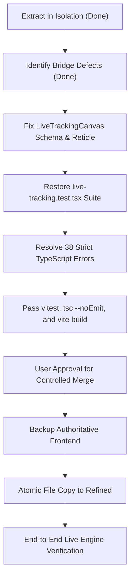

# AIR POINT — SAFE INTEGRATION PLAN
**Target Destination:** `C:\Users\loges\Downloads\Air_Point_Control_Center_Refined`  
**Verified Source:** `C:\Users\loges\Downloads\air-point-control-center-redesign-verified`  
**Engine Repository (Read-Only):** `C:\Users\loges\Documents\antigravity\air_point_clean`  
**Forbidden Project:** `C:\Users\loges\Documents\antigravity\keen-carson` (DO NOT TOUCH)  
**Status:** **PENDING USER AUTHORIZATION (WORK STOPPED BEFORE MERGE)**  

---

## 1. Integration Decision & Safety Rationale

### Current State
As documented in `CANDIDATE_VALIDATION_REPORT.md`:
1. The redesign package introduces the modern Aero Obsidian visual system, 4 themes, 4 accent palettes, 2 density modes, truthful diagnostics, and calibrated cursor presets.
2. However, copying the package directly into `Air_Point_Control_Center_Refined` as-is would **cause an immediate regression**:
   - `TypeError: hands.map is not a function` when connecting to the live Python engine.
   - `NaN` facial landmark coordinates.
   - 38 TypeScript compilation errors under strict mode.
   - Loss of `live-tracking.test.tsx` and the fingertip target ring visuals.

### Safety Guarantee
**We do NOT overwrite or merge into the authoritative frontend until all defects are surgically remediated and fully verified in isolation.**

---

## 2. Surgical Remediation Plan (To be executed in isolated verified folder)

Before any files are copied to `Air_Point_Control_Center_Refined`, the following five remediation steps must be completed inside `C:\Users\loges\Downloads\air-point-control-center-redesign-verified`:



---

### Step 1: Remediate `live-tracking-canvas.tsx` (Bridge Schema Compatibility)
Update `src/components/air-point/live-tracking-canvas.tsx` with a **Dual-Schema Adapter**:
1. **Hands Schema Adapter:**
   Support both Python's native dictionary shape `{"right": [...], "left": [...]}` and array shape:
   ```typescript
   // Normalize hands into a standard array for rendering
   const normalizedHands: { name: "RIGHT" | "LEFT"; landmarks: NormalizedPoint[] }[] = [];
   if (landmarksData.hands) {
     if (Array.isArray(landmarksData.hands)) {
       // Support array format
       landmarksData.hands.forEach((h, i) => {
         if (h && h.landmarks && h.landmarks.length >= 21) {
           normalizedHands.push({
             name: (h.label || h.handedness || (i === 0 ? "RIGHT" : "LEFT")).toUpperCase() as any,
             landmarks: h.landmarks,
           });
         }
       });
     } else if (typeof landmarksData.hands === "object") {
       // Support Python engine dictionary format {"right": [...], "left": [...]}
       const r = (landmarksData.hands as any).right;
       const l = (landmarksData.hands as any).left;
       if (r && Array.isArray(r) && r.length >= 21) {
         normalizedHands.push({ name: "RIGHT", landmarks: r });
       }
       if (l && Array.isArray(l) && l.length >= 21) {
         normalizedHands.push({ name: "LEFT", landmarks: l });
       }
     }
   }
   ```
2. **Facial Anchor Adapter:**
   Support Python's `[x, y]` tuple structure for `lip_center`, `lip_contour`, `right_ear`, `left_ear`:
   ```typescript
   // Normalize face points so cx and cy never evaluate to NaN
   const facePoints: NormalizedPoint[] = [];
   if (landmarksData.face && typeof landmarksData.face === "object") {
     const f = landmarksData.face as any;
     if (Array.isArray(f.lip_contour)) {
       f.lip_contour.forEach(([x, y]: [number, number]) => facePoints.push({ x, y }));
     }
     if (Array.isArray(f.lip_center)) facePoints.push({ x: f.lip_center[0], y: f.lip_center[1] });
     if (Array.isArray(f.right_ear)) facePoints.push({ x: f.right_ear[0], y: f.right_ear[1] });
     if (Array.isArray(f.left_ear)) facePoints.push({ x: f.left_ear[0], y: f.left_ear[1] });
   }
   ```
3. **Restore Fingertip Target Ring:**
   Add class `.index-target-ring` with concentric target circles and cardinal ticks at landmark index 8 (index fingertip) when `is_locked` is active, preserving Phase 4.5 styling.
4. **Restore 640x480 Aspect Ratio:**
   Set SVG `viewBox="0 0 640 480"` to match the OpenCV webcam stream dimensions, eliminating coordinate warping.

---

### Step 2: Restore `src/test/live-tracking.test.tsx`
Copy the authoritative `live-tracking.test.tsx` into `src/test/` to ensure the test suite permanently protects against landmark schema regressions and target ring removals.

---

### Step 3: Resolve 38 Strict TypeScript Errors (`tsc --noEmit`)
1. **In `src/components/air-point/engine.tsx`:**
   Define explicit payload interfaces:
   ```typescript
   interface EngineSettingsPayload {
     hold?: unknown;
     sensitivity?: unknown;
     smoothing?: unknown;
     enabled?: unknown;
   }
   interface EngineEventItem {
     time?: unknown;
     action?: unknown;
     event?: unknown;
   }
   ```
   Or access via `settings["sensitivity"]` and `ev["time"]` to satisfy `noPropertyAccessFromIndexSignature`.
2. **In `src/lib/air-point-model.ts`:**
   Replace dot access on parsed `Record<string, unknown>` with indexed access (`parsed["theme"]`, etc.).
3. **In `src/routes/gestures.tsx`:**
   Add a type guard or non-null assertion:
   ```typescript
   const selectedGesture = GESTURE_SPECS.find((g) => g.id === selectedId) ?? GESTURE_SPECS[0]!;
   ```

---

### Step 4: Full Isolated Verification Gate
Execute the full gate inside `C:\Users\loges\Downloads\air-point-control-center-redesign-verified`:
1. `npx vitest run` -> 4 suites, all passing.
2. `npx tsc --noEmit` -> 0 errors.
3. `npm run build` -> Clean production build.

---

### Step 5: Controlled, Atomic Merge Strategy
Once authorized by the user:
1. **Create Snapshot Backup:**
   Create a timestamped archive of the current authoritative frontend:
   `C:\Users\loges\Downloads\Air_Point_Control_Center_Refined_backup_<timestamp>.zip`
2. **Selective File Synchronization:**
   Copy the verified, remediated files from `air-point-control-center-redesign-verified` into `Air_Point_Control_Center_Refined`:
   - `src/` (all components, routes, styles, tests)
   - `package.json`
   - `tsconfig.json`
   - `vite.config.ts`
   - `vitest.config.ts`
   - `components.json`
   - Documentation markdown files
3. **Preserve Untouched Environments:**
   - Do NOT touch `node_modules` (already linked/installed).
   - Do NOT touch `keen-carson` (strictly forbidden).
   - Do NOT touch Python source files in `air_point_clean`.

---

## 3. End-to-End Live Verification Instructions (For User)

Following merge, test the complete system:

1. **Launch Python Engine:**
   ```powershell
   cd C:\Users\loges\Documents\antigravity\air_point_clean
   .\.venv\Scripts\python main.py
   ```
   Verify console logs:
   `[INFO] core.control_server: Air Point Control Bridge bound to http://127.0.0.1:8765`
2. **Launch React Control Center:**
   ```powershell
   cd C:\Users\loges\Downloads\Air_Point_Control_Center_Refined
   npm run dev
   ```
   Open `http://localhost:8080` (or displayed port).
3. **Verify in Browser:**
   - **Overview:** Confirm live FPS (28-32 FPS), active tracking status, and live camera feed with aligned green hand skeleton.
   - **Appearance:** Toggle through Obsidian, Titanium, OLED, and Slate themes; confirm immediate theme switch and persistent reload.
   - **Cursor:** Move sensitivity and smoothing sliders; confirm toast sync with Python engine without errors.
   - **About:** Click "Copy diagnostics"; confirm live JSON output contains authentic engine stats.
