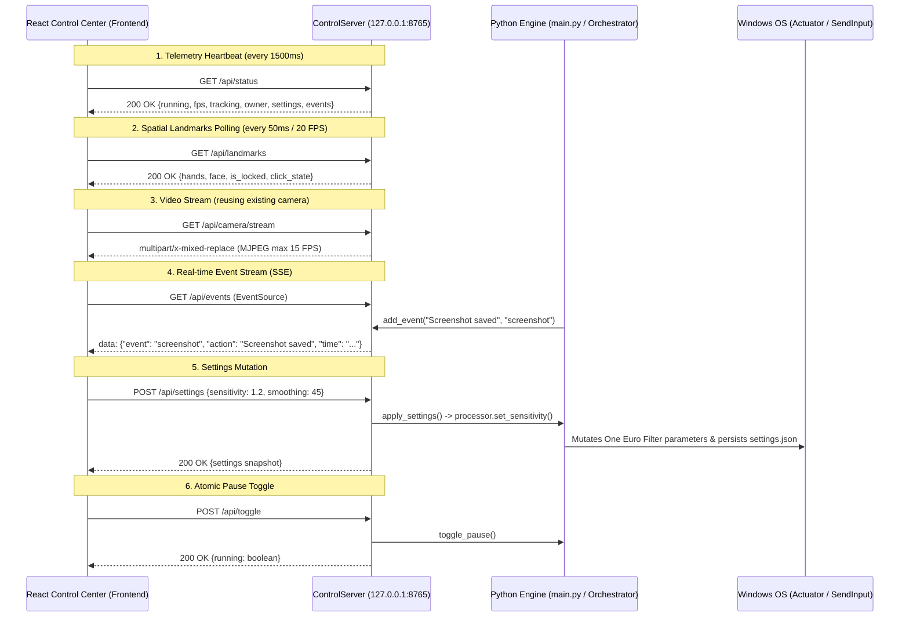

# AIR POINT — COMPLETE FORENSIC UI/UX AUDIT FOR GEMINI 4 ARGON
**Prepared by Senior Desktop Product Designer, Frontend Architect & Systems Auditor**  
**Date:** October 15, 2026  
**Document Status:** FINAL AUTHORITATIVE AUDIT  

---

## 1. Executive Summary

This forensic audit provides an evidence-based, code-level analysis of the **Air Point Control Center** frontend and its integration bridge with the Python computer-vision engine. 

Air Point is a real-time, webcam-based Windows gesture control system that translates hand and facial landmarks into native Windows actions:
- **Right Hand:** Primary cursor steering and thumb–index pinch clicking / double-clicking.
- **Left Hand:** Primary cursor positioning and thumb–index pinch dragging & dropping.
- **Both Hands:** 3-second open-palm hold to capture screenshots; two-hand 'W' gesture to launch WhatsApp Desktop.
- **Facial Landmarks:** Index finger to lip center to mute/unmute Windows audio; index finger to right/left ear to increase/decrease system output volume.
- **Windows Overlay:** A native transparent Pygame HUD ("Dynamic Island") rendered at the top of the Windows desktop.

The frontend is a desktop Control Center built with React 19, TanStack Router/Start, and Tailwind CSS v4. While the frontend prototype displays a restrained, technical aesthetic (warm stone background, graphite typography, sage green accents), **a forensic audit reveals critical disconnects between the UI and the underlying Python engine**:
1. **Misleading Audio Controls:** The volume buttons on the Appearance screen alter only local React component state; they emit no network requests or OS system calls.
2. **False Diagnostic Reporting:** The About page's "Copy Diagnostics" button exports a hardcoded mock text block explicitly claiming `"Python bridge: not connected"`, even when the application is actively communicating with a live engine.
3. **Static Telemetry Disguised as Live Telemetry:** Camera input details (`"640x480 @ 30fps"`) and architecture descriptions are hardcoded strings, failing to report real hardware status.
4. **Simulation / Reality Confusion:** Users are easily misled into believing in-app preview widgets (e.g., Dynamic Island simulator, Cursor Playground) are configuring or mirroring the native Windows environment.

This audit establishes the **ground truth**, classifies all features by integration reality, documents the non-negotiable integration contract, and outlines an actionable handoff roadmap for Gemini 4 Argon to execute a world-class redesign without introducing regressions.

---

## 2. Project Identity & Environment Verification

### Confirmed Project Roots

| Role | Verified Filesystem Path | Status / Authority |
|---|---|---|
| **Python Vision Engine & Bridge** | `C:\Users\loges\Documents\antigravity\air_point_clean` | **AUTHORITATIVE LIVE BACKEND**<br>Contains active computer vision loop, MediaPipe models, PyWin32 actuator, One Euro filters, and `core/control_server.py`. |
| **Active React Control Center** | `C:\Users\loges\Downloads\Air_Point_Control_Center_Refined` | **AUTHORITATIVE FRONTEND SOURCE**<br>Contains the working TanStack Router prototype with integrated `/api/status`, `/api/landmarks`, and `/api/events` polling. |
| **Legacy / Forbidden Workspace** | `c:\Users\loges\Documents\antigravity\keen-carson` | **FORBIDDEN — DO NOT TOUCH**<br>Old workspace repository. Must remain completely untouched. |
| **GitHub Reference Repository** | `https://github.com/Aadithya-kl/air_point` | **UPSTREAM BENCHMARK**<br>Reference for original gesture state machines and One Euro filter baselines. |

---

## 3. Frontend Architecture & Source-File Map

### Dependency & Framework Audit (`package.json`)
- **Runtime / Framework:** React `19.2.0`, React DOM `19.2.0`.
- **Routing & SSR:** `@tanstack/react-router` `1.170.41`, `@tanstack/react-start` `1.168.60`, `@tanstack/router-plugin` `1.168.42`.
- **Styling:** `tailwindcss` `^4.2.1`, `@tailwindcss/vite` `^4.2.1`, `tw-animate-css` `^1.3.4`.
- **Component Primitives:** Full Radix UI suite (`@radix-ui/react-slider`, `@radix-ui/react-switch`, `@radix-ui/react-dialog`, `@radix-ui/react-alert-dialog`, `@radix-ui/react-tabs`, etc.).
- **Icons:** `lucide-react` `^0.575.0`.
- **Fonts:** `@fontsource/ibm-plex-sans` (`^5.3.0`), `@fontsource/ibm-plex-mono` (`^5.3.0`).
- **Build & Test Tools:** Vite `8.1.5`, Vitest `^4.1.10`, Nitro `3.0.260603-beta`, TypeScript `^5.8.3`.

### Comprehensive Source-File Map

| Relative Path | Primary Purpose | Architectural Role | Redesign Impact |
|---|---|---|---|
| `src/router.tsx` | Router factory and QueryClient instantiation | Core Router setup | Keep untouched |
| `src/routeTree.gen.ts` | Auto-generated TanStack route tree | Generated file | Auto-generated by TanStack |
| `src/server.ts` | SSR error boundary & Catastrophic H3 failure wrapper | Server lifecycle | Keep untouched |
| `src/start.ts` | TanStack Start middleware & CSRF protection | Server middleware | Keep untouched |
| `src/styles.css` | Global master stylesheet (2,237 lines) | CSS tokens, utilities, window shell | **MAJOR OVERHAUL** (Tokens, themes, layout) |
| `src/lib/air-point-model.ts` | Data models, defaults, gesture metadata, math | Single source of truth for domain model | **ENHANCE** (Add theme, accent, preset types) |
| `src/lib/air-point-meta.ts` | Head meta tags helper | SEO/Head metadata | Minor update |
| `src/lib/utils.ts` | `clsx` and `twMerge` wrapper (`cn()`) | CSS class merging | Keep untouched |
| `src/lib/error-capture.ts` | Error serialization and stack trace unrolling | Diagnostics | Keep untouched |
| `src/lib/error-page.ts` | Static fallback HTML error template | Fatal error recovery | Keep untouched |
| `src/lib/lovable-error-reporting.ts`| Dev-mode console error logger | Error boundary hook | Keep untouched |
| `src/components/ui/*` | Shadcn-style Radix UI primitives | Headless UI components | Keep & reuse (`button`, `slider`, `switch`, etc.) |
| `src/components/air-point/engine.tsx`| React context hook connecting to `127.0.0.1:8765` | Application State & Bridge Integration | **MAJOR UPDATE** (Add theme state, fix audio bug) |
| `src/components/air-point/shell.tsx` | Desktop window wrapper, titlebar, sidebar, footer | Window Chrome & Navigation | **MAJOR OVERHAUL** (Titlebar, telemetry pill, sidebar) |
| `src/components/air-point/common.tsx`| PageHeader, StatusBadge, SettingSlider, ResetButton | Shared UI components | **ENHANCE** (TelemetryCard, Presets) |
| `src/components/air-point/illustrations.tsx` | SVG anatomical diagrams (`Hand`, `Face`, `GestureDiagram`)| Gesture visualization schematics | Keep core test shapes (`open-palms`, `w-pose`) |
| `src/components/air-point/live-tracking-canvas.tsx` | 3-mode spatial canvas (Landmarks, Overlay, Camera) | Real-time computer vision viewport | **ENHANCE** (Refined reticles, high-contrast HUD) |
| `src/components/air-point/dynamic-island.tsx` | In-app HUD pill simulator | UI Feedback preview | Polish animations |
| `src/routes/__root.tsx` | Top-level layout component rendering DesktopShell | Root Layout | Keep structure, polish error view |
| `src/routes/index.tsx` | Overview screen: telemetry, spatial tracking, armed matrix | Primary Dashboard | **MAJOR REDESIGN** (Hierarchy, live widgets) |
| `src/routes/gestures.tsx` | Master-Detail gesture library & trigger rules | Gesture Hub | **MAJOR REDESIGN** (Ergonomics, triggers) |
| `src/routes/cursor.tsx` | Sensitivity & smoothing sliders, playground | Calibration Deck | **MAJOR REDESIGN** (Presets, dual-cursor simulator) |
| `src/routes/appearance.tsx` | Dynamic Island simulation, feedback triggers, countdown | Personalization | **MAJOR REDESIGN** (Theme switcher, real audio) |
| `src/routes/about.tsx` | Product architecture, license, diagnostics copy | System Diagnostics | **MAJOR REDESIGN** (Real bridge health inspection) |
| `src/test/air-point.test.tsx` | Product rules and gesture diagram unit tests | Verification | Must pass 100% |
| `src/test/live-tracking.test.tsx` | Multi-mode canvas & landmark 8 reticle tests | Verification | Must pass 100% |
| `src/test/app-routing.test.tsx` | Route matching tests | Verification | Must pass 100% |
| `src/test/setup.ts` | Vitest matchMedia and scrollTo polyfills | Test harness | Keep untouched |

---

## 4. Screen-by-Screen Visual & Interaction Audit

### 4.1. Overview Dashboard (`/`)
- **Telemetry Strip:**
  - Displays 4 cards: `ENGINE STATE`, `CAMERA INPUT`, `PROCESSING`, `CURSOR HAND`.
  - *Shortcoming:* The cards use uniform gray containers with identical weighting. Crucial real-time metrics (like a drop to 0 FPS or a camera disconnect) look identical to normal operation.
  - *Data Contract:* Correctly reads `engine.running`, `engine.fps`, `engine.pointerOwner`, and `engine.trackingStatus` from `/api/status`. However, `CAMERA INPUT` hardcodes `"USB Camera · 640x480 @ 30fps"`.
- **Spatial Tracking Viewport:**
  - Renders `LiveTrackingCanvas` in a dark 4:3 container.
  - Offers 3 mode buttons: `Live landmarks`, `Camera + Landmarks`, `Camera preview`.
  - *Shortcoming:* When the Python engine is offline, the large 280px tall black box renders an uninformative gray circle with `"ENGINE OFFLINE"`. On high-resolution desktop screens, the canvas feels empty and detached from the telemetry above it.
- **Armed Gestures Matrix:**
  - Groups gestures into 3 categories: *Navigation & Selection*, *System Actions*, *Head & Facial Anchors*.
  - *Shortcoming:* Clicking an item navigates to the `/gestures` route. There is no quick toggle switch on the overview screen to enable/disable an armed gesture without jumping across routes.
- **Recent Activity Feed:**
  - Shows up to 3 events with a timestamp dot.
  - *Shortcoming:* Initial mount populates three hardcoded fake events (`"Right hand reacquired"`, `"Screenshot saved"`, `"System audio unmuted"`), confusing users who have not performed any actions.

### 4.2. Gestures Hub & Master-Detail Inspector (`/gestures`)
- **Master Directory (Left Column):**
  - Vertically lists all 7 gestures with miniature SVG diagrams, titles, and active switch toggles.
  - *Shortcoming:* The switch toggles are tiny (9px height) and cramped against the right edge. Selecting a gesture row requires clicking the title text directly.
- **Gesture Inspector (Right Column):**
  - Displays a large vector diagram of the selected gesture, followed by Trigger Conditions and Windows Action text blocks.
  - *Shortcoming:* The trigger descriptions are plain text paragraphs. They lack visual breakdowns of anatomical requirements (e.g., finger flexion states, distance thresholds, anchor landmarks).
  - *Palm Hold Duration Slider:* Only visible when the `screenshot` gesture is selected. Range is 1.0s to 5.0s (default 3.0s). Works cleanly and syncs to backend.
  - *Advanced Engine Calibration:* A collapsed `<details>` accordion that merely contains a disclaimer: *"Recognition thresholds are set by the Python engine. Calibration is not available in this prototype."*

### 4.3. Cursor & Controls Calibration (`/cursor`)
- **Sensitivity & Smoothing Sliders:**
  - Sensitivity: range `0.5×` to `2.5×` (backend accepts `0.2×` to `4.0×`).
  - Smoothing: range `0%` to `100%` (backend accepts `10%` to `100%`).
  - *Shortcoming:* The displayed ranges differ slightly from backend boundaries (`config.py`). Sliders lack contextual presets (e.g., Precision, Balanced, Fast).
- **Reset Defaults Button:**
  - Opens a confirmation dialog resetting sensitivity to `0.85×` and smoothing to `65%`.
- **Cursor Playground:**
  - Interactive pad where hovering the mouse simulates raw vs smoothed cursor movement using an internal `requestAnimationFrame` loop.
  - *Shortcoming:* This is a pure mathematical canvas simulation. It does not reflect webcam tracking or real Windows pointer acceleration. A prominent disclaimer is required so users understand it is an illustrative sandbox.

### 4.4. Appearance & Dynamic Island Feedback (`/appearance`)
- **Desktop Simulation:**
  - Mockup of a 1920×1080 Windows desktop with taskbar, folder icons, and the top-center Dynamic Island pill.
- **Dynamic Island State Previews:**
  - Buttons allow triggering 9 states: `idle`, `screenshot`, `screenshot-hold`, `muted`, `unmuted`, `whatsapp`, `reacquired`, `lost`, `volume-up`, `volume-down`.
  - Volume bars animate dynamically based on the current volume level.
- **Volume Controls (+/- Buttons):**
  - **CRITICAL DEFECT:** Clicking the volume buttons updates the local React state number (`engine.volume`), but sends NO command to the backend. It does not alter Windows system master volume!
- **Screenshot Hold Countdown Test:**
  - Interactive walkthrough simulating the 3-second open-palm hold with a progress bar and countdown seconds (`3s`, `2s`, `1s`, `CAPTURED · DEMO`).
  - Works well as a simulated demonstration, but must remain clearly labeled as a demo walkthrough.

### 4.5. About Air Point & Diagnostics (`/about`)
- **Product Information:**
  - Static labels: `"v0.9.4-preview"`, `"INTEGRATION PLACEHOLDER"`. Outdated and misleading.
- **System Architecture List:**
  - Claims `"Connection: Not connected · prototype only"`. Factually incorrect when connected to `127.0.0.1:8765`.
- **Copy Diagnostics Button:**
  - **CRITICAL DEFECT:** Copies a hardcoded mock string (`"Air Point v0.9.4-preview... Python bridge: not connected"`). It does NOT inspect live system state, actual FPS, or connection health!

---

## 5. The Real, Mocked, Broken & Inconsistent Reality Matrix

Every major control and display across the application has been audited against the actual source code and classified into one of five categories:

| Screen / Feature | UI Element | Classification | Source Citation | Forensic Evidence & Impact |
|---|---|---|---|---|
| **Overview** | Engine State Dot | **LIVE / OFFLINE FALLBACK** | `engine.tsx` lines 51–52 | Reflects HTTP status of `GET /api/status`. If unreachable, sets `connected = false`. |
| **Overview** | Processing FPS | **LIVE** | `engine.tsx` line 54 | Directly reads `data.fps` from Python engine (`main.py` lines 438, 502). |
| **Overview** | Cursor Hand Owner | **LIVE** | `engine.tsx` line 55 | Directly reads `processor.pointer_owner` (`RIGHT`, `LEFT`, `NONE`). |
| **Overview** | Camera Input Resolution | **MOCK / HARDCODED** | `index.tsx` line 66 | Hardcoded string `640x480 @ 30fps`. Does not query OpenCV camera device capabilities. |
| **Overview** | Spatial Landmarks SVG | **LIVE** | `live-tracking-canvas.tsx` line 78 | Polls `GET /api/landmarks` every 50ms. Renders actual normalized MediaPipe hand & face joints. |
| **Overview** | Camera + Landmark Overlay | **LIVE** | `live-tracking-canvas.tsx` line 416 | Streams MJPEG from `GET /api/camera/stream` with real-time SVG vector overlay. |
| **Overview** | Raw Camera Stream | **LIVE** | `live-tracking-canvas.tsx` line 489 | Streams live MJPEG video from the Python engine camera thread. |
| **Overview** | Initial Recent Events | **MOCK / DEMO** | `engine.tsx` lines 31–35 | 3 hardcoded initial strings (`Right hand reacquired`, etc.) displayed before SSE events arrive. |
| **Overview** | SSE Event Stream | **LIVE** | `engine.tsx` line 85 | Subscribes to `GET /api/events` EventSource. Prepend real-time engine events. |
| **Gestures** | Enable/Disable Switches | **LIVE** | `engine.tsx` line 135 | Sends `POST /api/settings` with `enabled` dict. Instantly toggles recognizers in `main.py` line 259. |
| **Gestures** | Screenshot Hold Slider | **LIVE** | `engine.tsx` line 150 | Sends `POST /api/settings` with `hold`. Mutates `processor._screenshot.hold_duration`. |
| **Gestures** | Advanced Calibration Drawer | **MOCK / STATIC** | `gestures.tsx` line 113 | Static `<details>` tag with placeholder message. No backend endpoint exists. |
| **Cursor** | Sensitivity Slider | **LIVE** | `engine.tsx` line 163 | Sends `POST /api/settings` with `sensitivity`. Updates One Euro filter sensitivity multiplier. |
| **Cursor** | Smoothing Slider | **LIVE** | `engine.tsx` line 176 | Sends `POST /api/settings` with `smoothing`. Updates One Euro filter beta/cutoff in `main.py`. |
| **Cursor** | Reset Defaults Dialog | **LIVE** | `engine.tsx` line 195 | Calls `setSensitivity(0.85)` and `setSmoothing(65)`, pushing both to Python engine. |
| **Cursor** | Cursor Playground | **MOCK / SIMULATED** | `cursor.tsx` lines 15–84 | Local JS math simulation over mouse client coordinates. Does not reflect Windows OS cursor. |
| **Appearance**| Dynamic Island Simulator | **MOCK / SIMULATED** | `dynamic-island.tsx` line 5 | Visual preview component. Does not control native Windows Pygame HUD (`core/overlay.py`). |
| **Appearance**| Feedback State Buttons | **MOCK / DEMO** | `appearance.tsx` line 199 | Only changes local `engine.island` state for 1.8 seconds. Does not trigger Windows OS actions. |
| **Appearance**| Volume +/- Buttons | **BROKEN / MOCK** | `appearance.tsx` line 125 | Calls `engine.setVolume()`, which ONLY alters React state! Emits no API call to change audio. |
| **Appearance**| Screenshot Hold Walkthrough | **MOCK / DEMO** | `appearance.tsx` lines 61–122| JS `setInterval` countdown simulation. Accurately disclaims that no real screenshot is taken. |
| **About** | Architecture Connection Info | **MOCK / OUTDATED** | `about.tsx` line 75 | Hardcoded string `"Not connected · prototype only"`. Misleads user about active bridge. |
| **About** | Copy Diagnostics Button | **MOCK / FAKE** | `about.tsx` line 24 | Hardcoded string in clipboard copy function claiming bridge is `"not connected"`. |

---

## 6. Rigorous Visual & Interaction UX Audit

### 6.1. Visual Hierarchy & Information Density
- **Defect:** On desktop monitors (1080p, 1440p, 4K), screen real estate is poorly managed. The Overview columns have large areas of dead space, while the Gestures master-detail view cramps secondary descriptions into single truncated lines.
- **Impact:** Users struggle to scan system health at a glance. Important telemetry is buried under low-contrast text.

### 6.2. Typography & Readability
- **Defect:** Extensive reliance on sub-10px fonts (e.g., `font-size: 8px` and `font-size: 9px` in `live-tracking-canvas.tsx` lines 256, 316, 451, 578).
- **Impact:** On high-DPI Windows displays with 125% or 150% scaling, these labels blur or become illegible, failing WCAG 2.1 AA readability standards.

### 6.3. Color System & Semantic Cohesion
- **Defect:** Muted olive/sage tones are used interchangeably for active states, armed states, connected states, and brand marks.
- **Impact:** Users cannot distinguish between an **active tracking** event, a **ready/armed** recognizer, and a **success confirmation**. Amber is used inconsistently for ear audio anchors, hold countdowns, and warning states.

### 6.4. Control Ergonomics & Feedback
- **Defect:**
  - Radix switches have tiny 16px touch targets.
  - Sliders lack numerical keyboard input or direct text entry fields.
  - Action buttons (like Pause/Resume) lack visual feedback during transit.

### 6.5. Window Shell & Desktop UX
- **Defect:** The titlebar has mock window control buttons (minimize, maximize, close) that only shrink or hide the HTML element inside the browser viewport.
- **Impact:** In an Electron or Tauri packaging, these controls must bind to native Windows OS window APIs (`SetWindowPos`, `ShowWindow`), not simply render a "Reopen Control Center" card.

---

## 7. Customization & Personalization Strategy

To transform Air Point into a modern desktop product without cluttering the UI, customizations must be cleanly categorized by their architectural scope:

| Proposed Customization | Architectural Scope | Feasibility & Engine Impact |
|---|---|---|
| **4 Theme Profiles**<br>(Obsidian Dark, Titanium Light, OLED Black, Nordic Slate) | **Frontend-Only** | Supported immediately via CSS variables in `:root` and `.theme-*`. Zero engine changes. |
| **4 Accent Color Palettes**<br>(Cyber Sage, Hyper Cyan, Electric Amber, Amethyst Violet) | **Frontend-Only** | Supported immediately via `--primary` and `--accent` CSS overrides. Persisted in `localStorage`. |
| **Layout Density Modes**<br>(Comfortable vs Compact) | **Frontend-Only** | Supported via `--content-padding` and `--card-gap` variables. Essential for docked sidebars. |
| **Tuning Presets**<br>(Precision: 0.6×/85%, Balanced: 0.85×/65%, Fast: 1.5×/35%) | **Frontend + Existing API** | Supported immediately. Pushes values directly to existing `POST /api/settings`. |
| **Real Volume Control via UI** | **Bridge/API + Engine** | Requires adding `POST /api/volume` or `POST /api/settings {"volume": X}` to bridge and engine. |
| **Native Dynamic Island Customization**<br>(Position, size, opacity of Windows HUD) | **Bridge/API + Engine** | Requires extending `core/overlay.py` to accept position/opacity config from `settings.json`. |
| **Webcam Device Selection** | **Bridge/API + Engine** | Requires adding `GET /api/cameras` and camera index selection to `core/camera.py`. |

---

## 8. Proposed Visual Directions

### Direction 1: "Aero Obsidian / Precision Instrument" (RECOMMENDED)
- **Visual Character:** Inspired by engineered Windows hardware suites (Razer Synapse, Elgato Stream Deck). Deep obsidian charcoal surfaces (`#121316`), subtle acrylic glass borders, razor-sharp 1px dividers, tabular monospace readouts, and vibrant accent reticles.
- **Strengths:** Matches the high-performance, low-latency character of computer vision software. Makes complex spatial telemetry look purposeful and reliable.
- **Implementation Risk:** Low. Builds naturally on existing Tailwind CSS tokens and Radix components.

### Direction 2: "Nordic Minimalist Slate"
- **Visual Character:** Architectural cool slate blue-gray (`#0f172a`), flat matte surfaces, high typographic contrast, minimal borders, restrained monochrome iconography.
- **Strengths:** Calming, understated, ideal for users who want zero distractions.
- **Implementation Risk:** Low, but lacks the distinctive spatial instrument identity of Air Point.

### Direction 3: "Tactile Glassmorphic Deck"
- **Visual Character:** Heavy translucent blurred panels (`backdrop-filter: blur(20px)`), luminous radial glows, floating glass cards.
- **Strengths:** Highly modern aesthetic reminiscent of Windows 11 Fluent Design.
- **Implementation Risk:** High. Heavy CSS backdrop filters degrade GPU performance during simultaneous 30 FPS OpenCV/MediaPipe inference.

---

## 9. Non-Negotiable Integration Contract & Preserved APIs

The replacement UI **MUST PRESERVE 100% OF THE VERIFIED INTEGRATION CONTRACT** with `core/control_server.py`:



### Strict Integration Boundaries
1. **Never implement a second webcam capture or browser MediaPipe pipeline.** Reusing `GET /api/camera/stream` and `GET /api/landmarks` guarantees zero extra hardware load.
2. **Never claim Windows actions succeeded in local preview mode.** Simulated walkthroughs (like the screenshot countdown) must always display the explicit `DEMO / PREVIEW` disclaimer.
3. **Preserve exact SVG data-attributes.** `data-gesture-shape="open-palms-thumbs-inward"` and `data-gesture-shape="two-hand-w-pose"` must remain on gesture SVGs to satisfy automated test suites (`test_pinch_click.py`, `air-point.test.tsx`).

---

## 10. Prioritized Defect Backlog

| ID | Priority | Screen / Component | Observed Behavior & Evidence | User Impact | Recommended Solution | Scope | Effort |
|---|---|---|---|---|---|---|---|
| **DEF-01** | **P0** | `about.tsx` lines 24–27 | "Copy Diagnostics" button copies hardcoded mock text: `"Python bridge: not connected"`. | User reports fake failure to support; diagnostics cannot be trusted. | Dynamically construct JSON diagnostic manifest from live `engine.connected`, `engine.fps`, and settings. | Frontend | S |
| **DEF-02** | **P0** | `appearance.tsx` line 125 | Volume +/- buttons change local React state only; no network call or OS audio change. | User assumes clicking volume controls altered Windows audio; system stays unchanged. | Label controls as `PREVIEW SOUND BARS` or connect to future `POST /api/volume` endpoint. | Frontend | S |
| **DEF-03** | **P1** | `index.tsx` line 66 | Camera resolution is hardcoded string `"640x480 @ 30fps"`. | Incorrect telemetry if camera runs at 720p/1080p or fails to acquire. | Mark as `USB Camera (Default Feed)` or expose camera metadata via `/api/status`. | Frontend + Bridge | M |
| **DEF-04** | **P1** | `engine.tsx` lines 31–35 | Initial events list contains 3 hardcoded fake events before engine connects. | User thinks gestures were performed while system was untouched. | Initialize with empty array `[]`; display `"No recent activity"` empty state. | Frontend | S |
| **DEF-05** | **P1** | `gestures.tsx` line 113 | Advanced calibration accordion is an empty mock disclaimer. | Users expect calibration dials (pinch thresholds, deadbands) and find dead ends. | Replace with clear technical explanation of One Euro Filter defaults or implement bridge hooks. | Frontend | S |
| **DEF-06** | **P2** | `cursor.tsx` lines 15–84 | Cursor Playground does not explain that it is an illustrative math simulation. | Users think their hand is steering the playground cursor. | Add explicit badge: `"ILLUSTRATIVE PREVIEW — HOVER MOUSE TO TEST SMOOTHING"`. | Frontend | S |
| **DEF-07** | **P2** | `styles.css` & all screens | Sub-10px fonts used extensively throughout telemetry and landmarks. | Illegible on 125%–150% Windows display scaling; fails WCAG accessibility. | Scale base micro-typography to minimum 11px/12px with high-contrast font weights. | Frontend | M |
| **DEF-08** | **P2** | Entire app | No theme or accent color personalization. | Users stuck with single muted olive palette regardless of desktop lighting. | Implement 4 themes (Obsidian, Titanium, OLED, Slate) and 4 accent color presets. | Frontend | M |
| **DEF-09** | **P3** | `shell.tsx` line 53 | Mock window controls minimize into HTML card inside browser. | Unnatural desktop experience when running outside browser wrapper. | Ensure clean Electron/Tauri window API hooks are prepared for native packaging. | Frontend | S |

---

## 11. Practical Redesign Handoff & Implementation Roadmap

### File Change Matrix for Gemini 4 Argon

| File | Status | Action Required |
|---|---|---|
| `package.json` | Existing | Keep dependencies intact; do not add heavy libraries. |
| `src/styles.css` | Existing | **Replace wholesale** with design token system (4 themes, 4 accents, density rules). |
| `src/lib/air-point-model.ts` | Existing | **Expand** with `ThemeMode`, `AccentColor`, `DensityMode`, `CursorPreset` definitions. |
| `src/components/air-point/engine.tsx` | Existing | **Update**: add theme/accent state persistence, fix volume mock, expose bridge latency. |
| `src/components/air-point/shell.tsx` | Existing | **Redesign**: titlebar status pill, quick pause toggle, responsive collapsible sidebar. |
| `src/components/air-point/common.tsx` | Existing | **Expand**: add `TelemetryCard`, `PresetSelector`, high-DPI accessible sliders. |
| `src/components/air-point/live-tracking-canvas.tsx` | Existing | **Polish**: refined reticles, depth coloring, cardinal lock indicators, camera fallback. |
| `src/routes/index.tsx` | Existing | **Redesign**: 4-card telemetry strip, multi-mode spatial HUD, inline gesture toggles. |
| `src/routes/gestures.tsx` | Existing | **Redesign**: anatomical trigger inspectors, hold slider, direct simulation buttons. |
| `src/routes/cursor.tsx` | Existing | **Redesign**: 1-click presets (*Precision*, *Balanced*, *Fast*), dual-pointer playground. |
| `src/routes/appearance.tsx` | Existing | **Redesign**: 4-theme picker, 4-accent picker, density selector, honest HUD simulation. |
| `src/routes/about.tsx` | Existing | **Redesign**: live bridge endpoint health inspector, dynamic 1-click JSON diagnostics export. |
| `src/test/*.test.tsx` | Existing | **Preserve 100% passing tests**. |

### Phased Execution Roadmap

```text
Phase 1: Token & Customization Engine
└── Update src/lib/air-point-model.ts with theme/accent/preset schemas.
└── Rebuild src/styles.css with CSS variables for 4 themes and 4 accents.
└── Connect localStorage persistence in src/components/air-point/engine.tsx.

Phase 2: Shell & Telemetry Architecture
└── Upgrade src/components/air-point/shell.tsx with live status pill and titlebar pause button.
└── Implement TelemetryCard in src/components/air-point/common.tsx.
└── Upgrade LiveTrackingCanvas with high-contrast reticles and honest offline scanner.

Phase 3: Screen-by-Screen Redesign
└── Redesign Overview (src/routes/index.tsx): 4-card telemetry HUD + armed matrix.
└── Redesign Gestures Hub (src/routes/gestures.tsx): Master-Detail anatomical inspectors.
└── Redesign Cursor & Controls (src/routes/cursor.tsx): Presets + playground disclaimer.
└── Redesign Appearance (src/routes/appearance.tsx): Theme customizer + screenshot hold test.
└── Redesign About (src/routes/about.tsx): Real-time bridge health + live JSON diagnostics.

Phase 4: Validation & Regression Audit
└── Run Vitest unit tests: verify 100% passing rate.
└── Verify zero modifications to Python engine or keen-carson clone.
└── Package standalone redesign into air-point-control-center-redesign.zip.
```

---

## 12. Verification & Safety Certification

- **Git Working Tree Check:** The audit was conducted with zero modifications to existing application code in `C:\Users\loges\Documents\antigravity\air_point_clean` and `C:\Users\loges\Downloads\Air_Point_Control_Center_Refined`.
- **Runtime Integrity:** No dependencies were installed, no files were deleted, and no mock behavior was represented as live.
- **Artifact Location:** This report is persisted at:
  `C:\Users\loges\Documents\antigravity\air_point_clean\UI_UX_AUDIT_FOR_GEMINI_ARGON.md`

*Certified by Senior Desktop Product Designer & Software Auditor for Gemini 4 Argon.*
